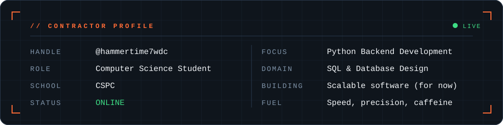
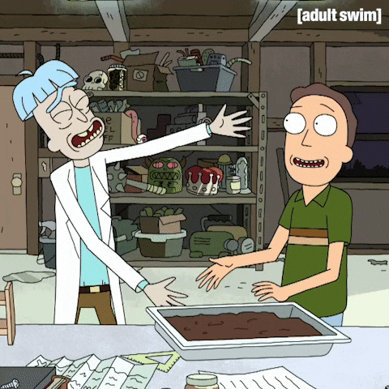
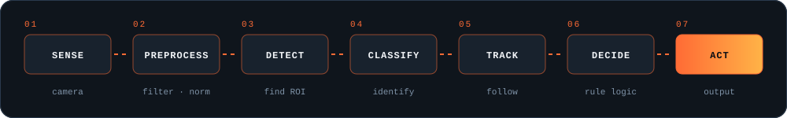
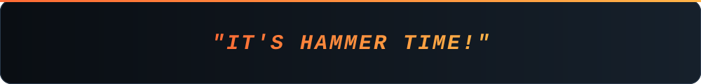

 

### // About Me

- **Computer Science Student** at CSPC
- Learning and focusing on **Python Backend Development, SQL & Database Design**
- Working on scalable software projects (for now)
- Aiming to get really good at **image recognition and computer vision**
- Fueled by speed, precision, and caffeine

 

### // Tech Stack & Tools

**Languages & Databases**

**DevOps, Cloud & Tools**

### // GitHub Stats

<picture>
  <source media="(prefers-color-scheme: dark)" srcset="https://github-readme-stats.vercel.app/api?username=hammertime7wdc&show_icons=true&theme=radical&hide_border=true&count_private=true">
  <source media="(prefers-color-scheme: light)" srcset="https://github-readme-stats.vercel.app/api?username=hammertime7wdc&show_icons=true&theme=default&hide_border=true&count_private=true">
  
</picture>
<picture>
  <source media="(prefers-color-scheme: dark)" srcset="https://github-readme-stats.vercel.app/api/top-langs/?username=hammertime7wdc&layout=compact&theme=radical&hide_border=true&langs_count=6">
  <source media="(prefers-color-scheme: light)" srcset="https://github-readme-stats.vercel.app/api/top-langs/?username=hammertime7wdc&layout=compact&theme=default&hide_border=true&langs_count=6">
  
</picture>

 

<picture>
  <source media="(prefers-color-scheme: dark)" srcset="https://streak-stats.demolab.com/?user=hammertime7wdc&theme=radical&hide_border=true">
  <source media="(prefers-color-scheme: light)" srcset="https://streak-stats.demolab.com/?user=hammertime7wdc&theme=default&hide_border=true">
  
</picture>

### // Connect with Me

 

